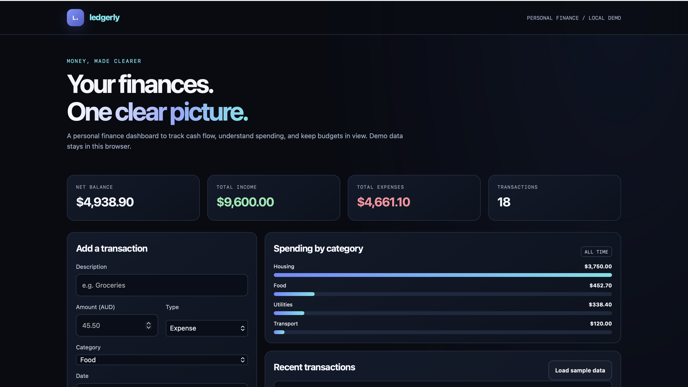

# Ledgerly — Personal Finance Dashboard

> A responsive personal-finance dashboard for tracking income, expenses and spending patterns.

**Live demo:** [https://khare-pratham.github.io/ledgerly/](https://khare-pratham.github.io/ledgerly/)

## Overview

Ledgerly is a browser-based finance-tracking prototype. Users can record income and expenses, categorise transactions, review cash-flow summaries, filter transaction history and export records to CSV.

## Features

- Record income and expense transactions with amount, category and date
- Calculate total income, expenses, net balance and transaction count
- Visualise expenses by category
- Filter transactions by description, category or type
- Delete transactions and clear local data
- Export transaction records as CSV
- Load sample transactions for a quick demonstration
- Persist records in browser local storage

## Tech stack

`HTML5` · `CSS3` · `Vanilla JavaScript` · `Browser localStorage` · `CSV export`

## How it works

The app is a static, client-side web app. HTML defines the dashboard and transaction form, CSS provides responsive styling, and JavaScript validates input, updates summaries, renders category breakdowns and transaction rows, and persists records in localStorage. No server or database is connected.

## Run locally

1. Clone or download this repository.
2. Open `index.html` in a browser.

If local-file restrictions interfere, run this from the project folder:

```bash
python3 -m http.server 8000
```

Then visit `http://localhost:8000`.

## Test checklist

- [ ] Add income and confirm income and balance increase
- [ ] Add an expense and confirm expenses and balance update
- [ ] Filter transactions by description or category
- [ ] Delete a transaction and verify the summary recalculates
- [ ] Export CSV and verify expected rows
- [ ] Refresh and verify data persists in the same browser

## Known limitations

- Browser-local storage only; no account system, cloud sync, server or database
- Data can be lost if browser storage is cleared and is not suitable for sensitive financial records
- Category totals are all-time totals; monthly budgets and date-range filters are not implemented
- This is a learning project, not a bank-connected service or financial advice

## Potential improvements

- Add unit tests for calculation and validation logic
- Add date filters and configurable category budgets
- Separate UI, domain logic and persistence into modules
- Add accessibility checks and automated browser tests

## Screenshots

(ledgerly-dashboard1.png)

## Project status

Portfolio prototype. This README distinguishes implemented features from potential future improvements.
